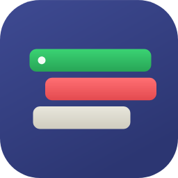
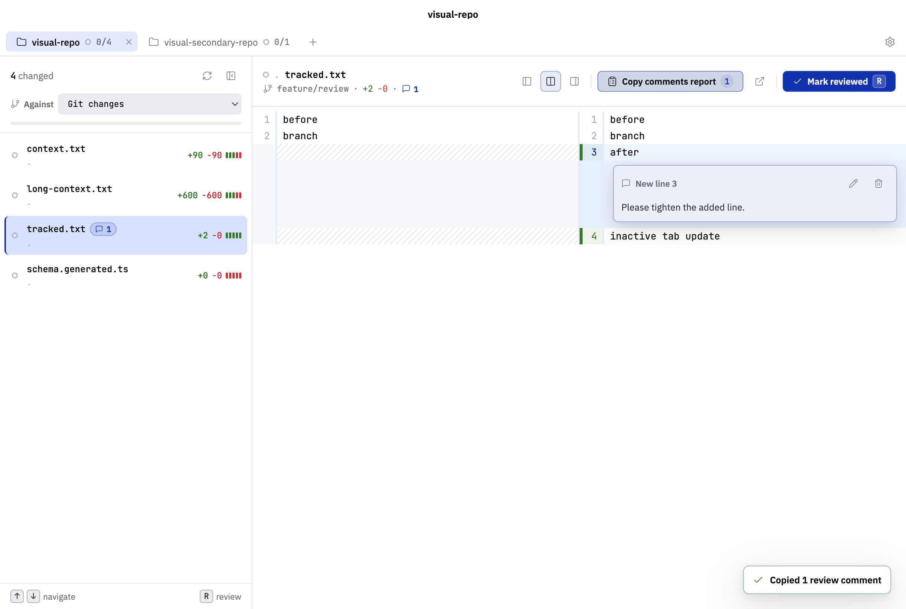
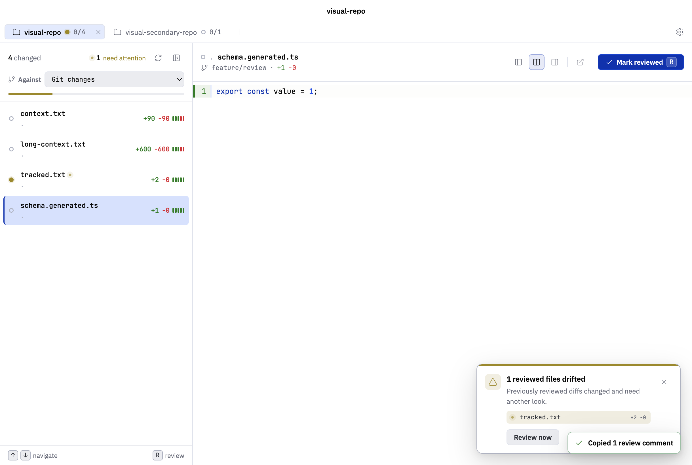
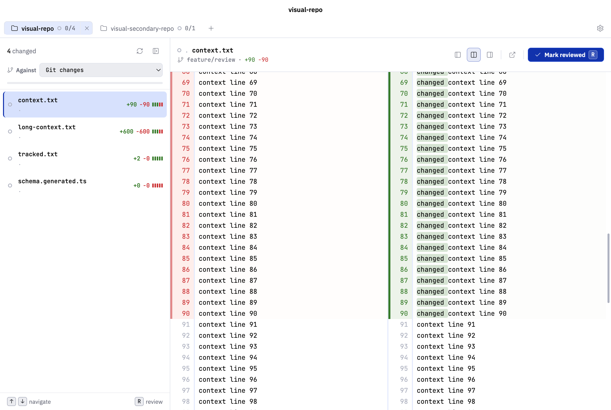
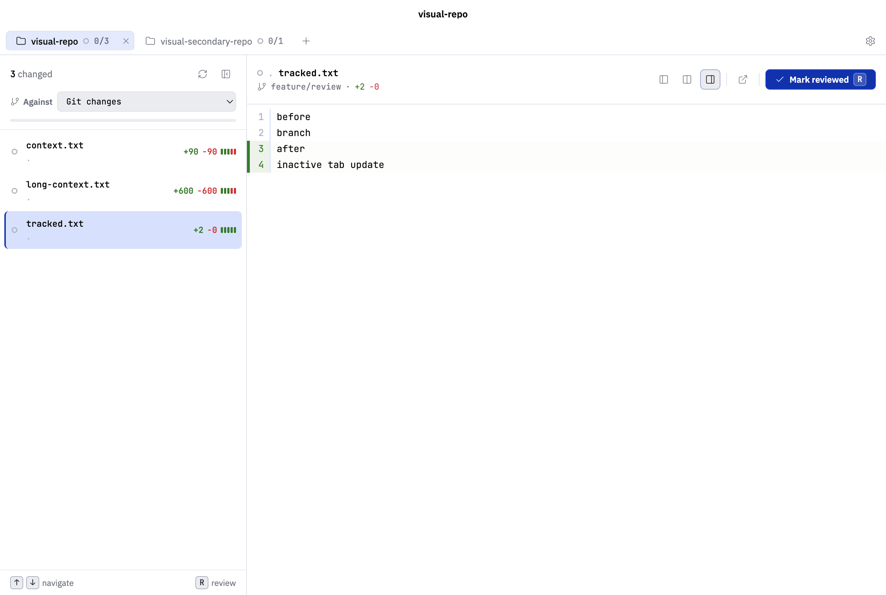

<p align="center">
  
</p>

# Difftray

Difftray is a local-first macOS desktop app for reviewing Git changes across multiple projects. It tracks which files you have reviewed and clears that review state when a file's diff changes. Your review comments become a ready-made prompt for your coding agent or AI tool, and agents can read and write review feedback through a bundled CLI.

Difftray shows what changed, what you already reviewed, and what needs another look.

Difftray only reviews local Git changes. It does not edit code, run AI agents, or host pull requests.

## Why Difftray?

Why not use a regular Git diff client?

I built this because I kept losing track of my own reviews. I'd skim a diff, an agent would iterate, I'd come back, and I had no idea which files were still the ones I'd looked at and which had moved underneath me.

A few things came out of that:

- **Reviewed files don't stay reviewed if they change.** Mark a file as reviewed. If the diff for that file changes later, Difftray drops it back to unreviewed so you know to look again. It does not tell you _what_ changed, only that something did, so your previous pass no longer covers the current diff.
- **It's built around the iteration loop.** Working tree changes, branch changes,
  and a single committed patch all use the same review flow. The flow is for
  checking what an agent (or you) just changed, before any pull request exists.
- **Comments are meant to go back to the agent.** Leave line, range and file comments and an overall note while reviewing. Then copy them out as a prompt, or let the agent read them directly through the CLI.

## Current Features

- Keep several local repositories open in one review desk.
- See which projects still need attention without switching context.
- Review working tree changes, branch changes against a local ref, or a single
  recent/pasted commit with the same focused workflow.
- Move through changed files quickly. Difftray hides noisy generated files by
  default.
- Read diffs in the shape that fits the moment: side-by-side, unified, expanded context, or focused on one side.
- Mark files reviewed and Difftray will flag them if they change later.
- Leave line, range and file comments plus an overall review note, then copy a ready-made prompt to paste back into your agent or AI tool.
- Let a coding agent open the worktree in Difftray, read your feedback, and submit its own attributed review findings through the bundled CLI and portable skill.
- Drive review from the keyboard, command palette, or dense file list controls.
- Pair Difftray Companion on a phone or tablet to review the same local projects
  from another device on your private network.
- Open the selected file in the system default editor or an installed common
  editor preset.
- Configure app appearance, default diff mode, line wrapping, generated-file
  visibility, drift notifications, phone companion access, and editor launch
  behavior.
- Keep everything local. By design, Difftray never fetches, pushes, stages, edits files, or writes repository metadata.

## Phone Companion

The phone companion server is off by default. Enable it from Settings ->
Phone companion, then pair a device with the QR code or six-digit manual code.

When enabled, Difftray starts a local HTTP/WebSocket server on the preferred
companion port, falling back within `48620-48629` if the preferred port is busy,
and advertises `_difftray._tcp` with Bonjour/mDNS. macOS may show a local-network
or firewall prompt the first time the server binds; allow it if you want phones
on the same trusted network to find the Mac.

Paired devices can see the projects already known to Difftray, their local
repository paths, review targets, file paths, diff text or binary markers,
review state, review comments, and generated comment reports. They can mark or
unmark files as reviewed, create/edit/delete comments, change the active diff
target, and receive encrypted workspace-change events. The companion never gets
Git credentials, shell access, staging/push/fetch controls, or arbitrary file
system access.

Use the companion on networks you trust. Same-LAN discovery is automatic when
mDNS works; Tailscale MagicDNS addresses are also included when available, which
is the recommended path for private cross-network use. See
[`docs/companion-protocol.md`](docs/companion-protocol.md) for the protocol and
security model.

## Screenshots

Review workflow with inline comments and a ready-made agent handoff prompt:



Reviewed-file drift notification after a diff changes:



Expandable unchanged context in split diff mode:



Focused new-side diff view:



## Install

Download the latest macOS build from the [Releases page](https://github.com/prof18/difftray/releases/latest):

- **Apple Silicon (M-series):** `Difftray-arm64.dmg`
- **Intel:** `Difftray-x64.dmg`

Open the `.dmg` and drag Difftray into your Applications folder.

## Agent workflows

Difftray works with coding agents such as Claude Code, Codex and Pi through two
pieces that ship inside the app: a command-line tool and a portable agent skill.
With them, an agent can:

- open the current Git worktree in Difftray, keeping the diff already selected
  for it or switching to a working-tree, branch or commit target;
- read every page of the review feedback, including the overall note and
  inactive comments;
- read the exact file diffs and submit review findings as single-line,
  inclusive-range, file or overall feedback, on either the added or the removed
  side of a diff;
- set or reset the worktree's display label in Difftray.

The agent writes feedback only when you ask it to submit. Loading the skill alone
authorizes no write, code edit, other agent or chat message. Difftray labels agent
feedback with the name the agent supplies. It shows that name for attribution
only and does not authenticate it. Five typed-only command skills
(`/difftray-open`, `/difftray-read`, `/difftray-fix`, `/difftray-review` and
`/difftray-label`) give each common request its own slash command.

The app includes the CLI at
`/Applications/Difftray.app/Contents/Resources/bin/difftray`. It runs without a
separate Node or npm installation. `doctor --json` checks the selected app and
connection, and review commands can start the installed app automatically. If the app
is in `~/Applications`, use that path instead. The bundled launcher follows its
own app when it is moved.

The [portable Difftray skill](integrations/agents/difftray/README.md) provides
review workflows for Codex, Claude Code, and Pi. Packaged apps include the
canonical skill and CLI. In Settings → Agents, choose **Install** to link the
skill into Claude Code (`~/.claude/skills/difftray`), Codex
(`~/.agents/skills/difftray`), Pi (`~/.pi/agent/skills/difftray`), or a folder
you choose for another agent. The link follows skill updates in place. If you
move the app, use **Repair** to update it. The skill finds the owning app from
its link, including Alpha and custom-named bundles. `DIFFTRAY_APP_PATH` remains
an explicit override for manual or developer use. Settings → Agents also offers
an optional **Install command-line tool** action that adds a `difftray` command
for your terminal. It does not edit shell startup files. See [agent setup and review
commands](docs/agent-integration.md#agent-skill-setup).

## Development

Prerequisites:

- Node.js 22 or newer
- pnpm 10.11.0 or newer
- Git available on `PATH`
- macOS for the intended desktop runtime

Install dependencies:

```sh
pnpm install
```

Run the desktop app in development:

```sh
pnpm dev
```

Build the app:

```sh
pnpm build
```

Run the full local CI gate before committing:

```sh
./ci.sh
```

`pnpm check` delegates to the same script.

Useful focused checks:

```sh
pnpm format
pnpm lint
pnpm typecheck
pnpm test
pnpm test:visual
pnpm bench:performance
```

Run `pnpm bench:performance` before and after changes that can affect large
changesets, workspace loading, file selection, mark-reviewed flow, diff loading,
diff rendering, review-state resolution, or bundle size.

## License

Apache-2.0.
